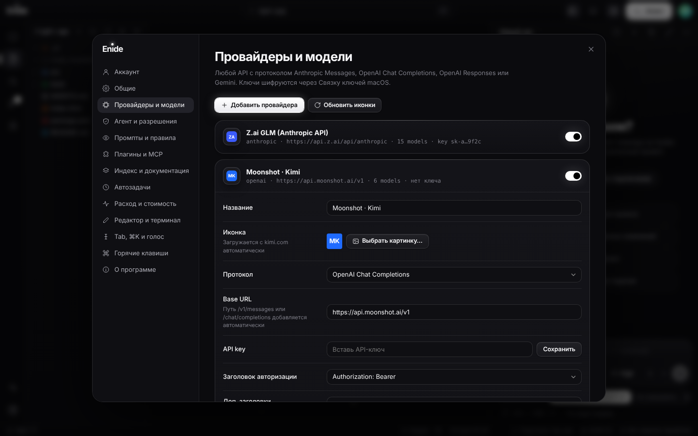
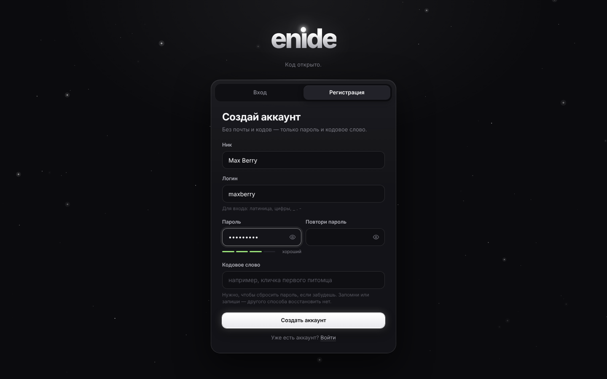

<div align="center">


# Enide

**Код открыто.** AI-IDE для macOS и Windows: любой провайдер, любая модель, никаких скрытых промптов.

[](https://github.com/dzhavidgasan-pixel/Enide/releases/latest)
[](https://github.com/dzhavidgasan-pixel/Enide/releases)


[](LICENSE)


</div>

## Скачать

| Система | Файл | |
|---|---|---|
| **macOS** · Apple Silicon (M1–M4) | [Enide-mac-arm64.dmg](https://github.com/dzhavidgasan-pixel/Enide/releases/latest/download/Enide-mac-arm64.dmg) | `.zip` — [тут](https://github.com/dzhavidgasan-pixel/Enide/releases/latest/download/Enide-mac-arm64.zip) |
| **macOS** · Intel | [Enide-mac-x64.dmg](https://github.com/dzhavidgasan-pixel/Enide/releases/latest/download/Enide-mac-x64.dmg) | `.zip` — [тут](https://github.com/dzhavidgasan-pixel/Enide/releases/latest/download/Enide-mac-x64.zip) |
| **Windows** 10/11 · x64 — установщик | [Enide-Setup-win-x64.exe](https://github.com/dzhavidgasan-pixel/Enide/releases/latest/download/Enide-Setup-win-x64.exe) | |
| **Windows** — без установки | [Enide-win-x64.zip](https://github.com/dzhavidgasan-pixel/Enide/releases/latest/download/Enide-win-x64.zip) | распаковать → `Enide.exe` |

Все версии — на странице [Releases](https://github.com/dzhavidgasan-pixel/Enide/releases).

<details>
<summary><b>macOS пишет «не удаётся проверить разработчика» или «файл повреждён»</b></summary>

Сборка не подписана платным сертификатом Apple. Один раз после установки:

- **Системные настройки → Конфиденциальность и безопасность → «Всё равно открыть»**, или
- в Терминале: `xattr -cr /Applications/Enide.app`
</details>

<details>
<summary><b>Windows показывает «Windows защитила ваш компьютер»</b></summary>

Нажми **«Подробнее» → «Выполнить в любом случае»**. Это предупреждение SmartScreen для программ без платной подписи.
</details>

## Начало работы

1. Открой Enide и **создай аккаунт**: ник, логин, пароль и кодовое слово. Без почты и кодов, кодовое слово нужно, чтобы сбросить забытый пароль.
2. **Настройки → Провайдеры и модели** (⌘, / Ctrl+,): выбери провайдера, вставь API-ключ, нажми **«Проверить подключение»**.
3. Открой папку с проектом (⌘O / Ctrl+O) и пиши агенту.

Ключи хранятся в Связке ключей macOS или в защищённом хранилище Windows и не попадают в файлы.

## Что умеет

<table>
<tr><td width="50%"></td><td width="50%"></td></tr>
<tr><td><sub>Код как в Cursor: номера строк, «Применить», «Копировать». Отправленный запрос можно изменить прямо в чате</sub></td><td><sub>Все модели провайдера уже в списке, с иконками компаний</sub></td></tr>
<tr><td></td><td></td></tr>
<tr><td><sub>Любой провайдер: Anthropic, OpenAI, Gemini, Kimi, GLM, DeepSeek, Qwen, OpenRouter, Ollama…</sub></td><td><sub>Аккаунт без почты: пароль и кодовое слово</sub></td></tr>
</table>

| | |
|---|---|
| **Агент** | читает и ищет по проекту, правит файлы, запускает команды (zsh на Mac, Git Bash / PowerShell на Windows), веб-поиск, субагенты, список задач |
| **Доступ** | под полем ввода: **Полный доступ** · **Спрашивать каждый раз** · **Не спрашивать**. Команду можно изменить перед запуском; ⌘⏎ — разрешить, Esc — отклонить |
| **Изменения** | каждая правка — дифф; после хода — список изменённых файлов, откат хода и откат к любому сообщению |
| **Контекст** | кольцо под полем ввода — точное число токенов от провайдера за последний запрос; клик — разбивка. Автосжатие при заполнении |
| **Reasoning** | размышления моделей в реальном времени: Anthropic, OpenAI, Gemini, DeepSeek, Kimi, GLM, Qwen, локальные `<think>` |
| **Вложения** | файлы и папки, zip/7z/rar/tar, картинки (вставка и drag & drop), скриншоты, выделение кода, git diff, вывод терминала, голос |
| **Чаты** | панель чатов, вкладки и параллельные агенты, git worktree на чат, поиск, закрепление, форк, чат на весь экран (⌘E) |
| **Редактор** | Monaco (движок VS Code), ⌘K-правка, Tab-автодополнение и «следующая правка», split, проблемы (tsc, eslint, ruff…), ИИ-ревью |
| **Ещё** | терминал, git, @Docs, семантический индекс, MCP и плагины, hooks в формате Claude Code, память, автозадачи, расход в $, темы и клавиши из VS Code/Cursor |

## Никаких скрытых промптов

- Всё, что Enide добавляет к запросу, — шаблоны в **Настройки → Промпты и правила**. Любой можно переписать или стереть.
- Правила проекта берутся из `AGENTS.md`, `CLAUDE.md`, `.cursorrules`, `.cursor/rules/*`, `.enide/rules/*` и других файлов, каждое можно выключить.
- **«Что видит модель»** под полем ввода показывает итоговый system prompt и все инструменты.
- **Лог запросов** — точное тело каждого запроса к модели, ключи замаскированы.
- Фоновых запросов нет: заголовок чата берётся из первого сообщения.

> Если API-шлюз сам добавляет промпт на своей стороне, IDE этого не видит.

## Провайдеры

Протоколы **Anthropic Messages**, **OpenAI Chat Completions**, **OpenAI Responses**, **Gemini**. Готовые пресеты: Anthropic, OpenAI, Gemini, OpenRouter, Z.ai (GLM), Moonshot (Kimi), DeepSeek, Qwen, MiniMax, xAI, Mistral, Groq, Together, Fireworks, Azure OpenAI, LiteLLM, Ollama, LM Studio и любой совместимый адрес. Для каждой модели настраиваются контекст, лимит вывода, vision, стиль reasoning, цены и доп. JSON к запросу.

## Плагины и MCP

**MCP**: каталог (Playwright, Context7, GitHub, Filesystem…), свой stdio/HTTP-сервер, импорт из Cursor / Claude Desktop / Claude Code / Windsurf.
**Плагины Enide**: папка с `enide-plugin.json` и `index.js`:

```js
exports.activate = (api) => {
  api.registerTool({ name, description, parameters, run: async (args, { root }) => 'result' });
  api.registerCommand({ id, title, run: async ({ root }) => 'message' });   // ⌘⇧P
  api.registerSlashCommand({ name, description, prompt: '… $ARGUMENTS' });   // в чате
};
```

## Горячие клавиши

`⌘P` файл · `⌘⇧P` команды · `⌘⇧F` поиск · `⌘L` выделение в чат · `⌘⇧L` новый чат · `⌘T` вкладка чата · `⌘K` правка · `⌘1–4` режим · `⌘B` боковая панель · `⌘E` чат на весь экран · `⌘J` терминал · `⌘,` настройки. На Windows — `Ctrl` вместо `⌘`.

## Сборка из исходников

```bash
git clone https://github.com/dzhavidgasan-pixel/Enide.git && cd Enide
npm install
npm start            # запустить
npm test             # тесты ядра и main-процесса
npm run dist         # macOS: .dmg/.zip в release/
npm run dist:win     # Windows: установщик и .zip
```

macOS: `bash install-mac.sh` собирает Enide.app, кладёт его в «Программы» и ярлык на рабочий стол.
Релизы собирает GitHub Actions (`.github/workflows/release.yml`): подними `version` в `package.json` и запушь в `main` — сборки для Mac (arm64 + x64) и Windows сами появятся в новом релизе.

## Честно о границах

- Расширения VS Code не запускаются: Enide не форк VS Code. Вместо них MCP и плагины.
- Сборки не подписаны платными сертификатами Apple и Microsoft, поэтому при первом запуске система предупреждает (см. «Скачать»).
- Аккаунт локальный: защищает вход на этом компьютере, синхронизации между устройствами нет.

## Лицензия

[MIT](LICENSE)
