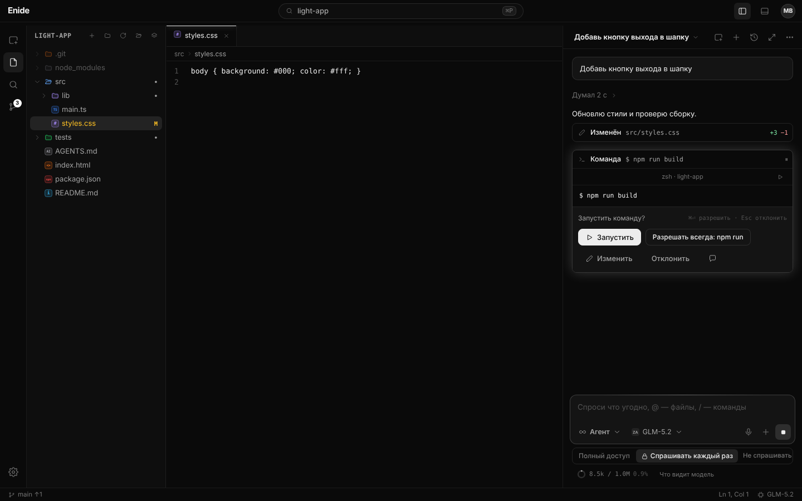
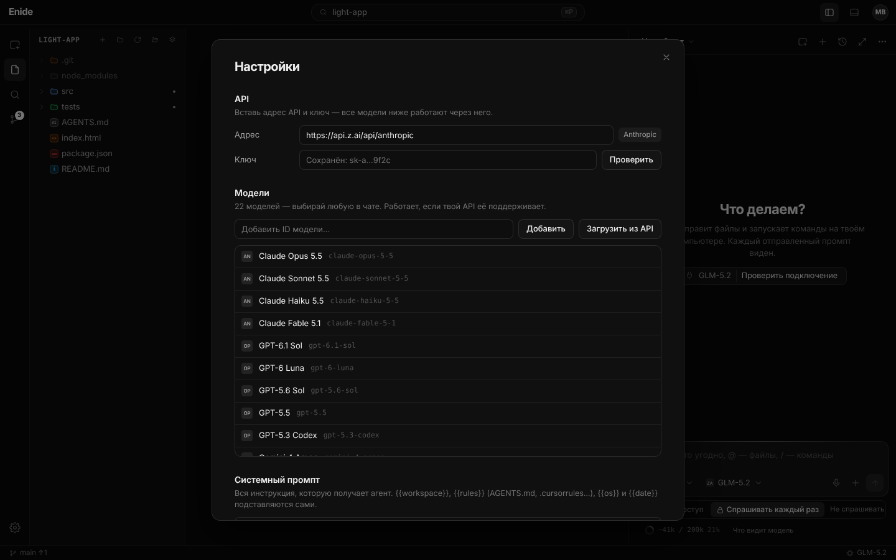
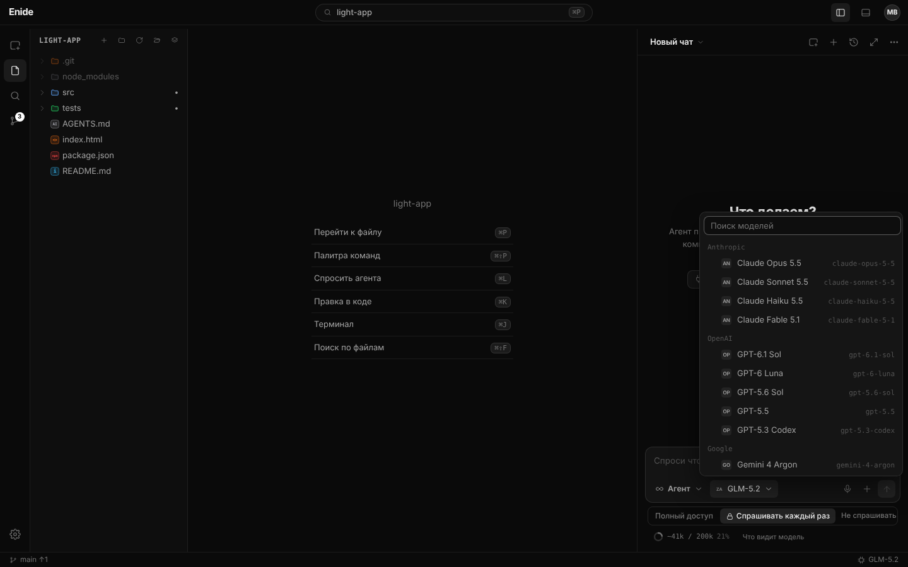

<div align="center">


# Enide

**Код открыто.** Простая AI-IDE для macOS и Windows: своя модель, свой ключ, никаких скрытых промптов.

[](https://github.com/dzhavidgasan-pixel/Enide/releases/latest)
[](https://github.com/dzhavidgasan-pixel/Enide/releases)


[](LICENSE)



</div>

## Скачать

| Система | Файл | |
|---|---|---|
| **macOS** · Apple Silicon (M1–M4) | [Enide-mac-arm64.zip](https://github.com/dzhavidgasan-pixel/Enide/releases/latest/download/Enide-mac-arm64.zip) | распаковать → перетащить **Enide** в «Программы» |
| **macOS** · Intel | [Enide-mac-x64.zip](https://github.com/dzhavidgasan-pixel/Enide/releases/latest/download/Enide-mac-x64.zip) | |
| **Windows** 10/11 · установщик | [Enide-Setup-win-x64.exe](https://github.com/dzhavidgasan-pixel/Enide/releases/latest/download/Enide-Setup-win-x64.exe) | |
| **Windows** · без установки | [Enide-win-x64.zip](https://github.com/dzhavidgasan-pixel/Enide/releases/latest/download/Enide-win-x64.zip) | распаковать → `Enide.exe` |

**Обновления приходят сами:** при запуске Enide проверяет новую версию, скачивает и ставит её одной кнопкой. Чаты, ключи и настройки остаются.

<details>
<summary><b>macOS пишет «не удаётся проверить разработчика»</b></summary>

Сборка не подписана платным сертификатом Apple. Один раз: **Системные настройки → Конфиденциальность и безопасность → «Всё равно открыть»**, или в Терминале `xattr -cr /Applications/Enide.app`.
</details>

<details>
<summary><b>Windows показывает «Windows защитила ваш компьютер»</b></summary>

**«Подробнее» → «Выполнить в любом случае».** Это SmartScreen для программ без платной подписи.
</details>

## Начало работы

1. Создай аккаунт: ник, логин, пароль и кодовое слово (без почты).
2. **Настройки → API**: вставь адрес API и ключ, нажми **«Проверить»**.
3. Выбери модель в списке под полем ввода — и работай.

Все модели уже в списке — те же семейства, что в Cursor:

| Семейство | Модели |
|---|---|
| Anthropic | Claude Opus 5.5 · Sonnet 5.5 · Haiku 5.5 · Fable 5.1 |
| OpenAI | GPT-6.1 Sol · GPT-6 Luna · GPT-5.6 Sol · GPT-5.5 · GPT-5.3 Codex |
| Google | Gemini 4 Argon · Gemini 3.8 Flash · Gemini 3.1 Pro |
| xAI | Grok 4.7 |
| Moonshot | Kimi K3.1 Pro · Kimi K3 · Kimi K2.6 |
| Z.ai | GLM-5.3 · GLM-5.2 · GLM-5.3 Flash |
| DeepSeek | DeepSeek V4 Pro · DeepSeek V4.1 Flash |

Запрос уходит на тот API, который ты вставил: будет ли работать модель, зависит от него. Нет нужной — **«Добавить ID модели»** или **«Загрузить из API»**. Протокол (Anthropic, OpenAI-совместимый, Gemini) определяется по адресу.

| Адрес API | |
|---|---|
| `https://api.z.ai/api/anthropic` | Z.ai (GLM) |
| `https://openrouter.ai/api/v1` | OpenRouter — все семейства сразу |
| `https://api.anthropic.com` | Anthropic |
| `https://api.openai.com/v1` | OpenAI |
| `https://api.moonshot.ai/v1` | Moonshot (Kimi) |
| `https://api.deepseek.com` | DeepSeek |
| `http://localhost:11434/v1` | Ollama |

<table>
<tr><td width="50%"></td><td width="50%"></td></tr>
<tr><td><sub>Настройки на одной странице: API, модели, системный промпт</sub></td><td><sub>Все модели в одном списке, по семействам</sub></td></tr>
</table>

## Что умеет

| | |
|---|---|
| **Агент** | читает и ищет по проекту, правит файлы, запускает команды, ищет в интернете, ведёт список задач |
| **Доступ** | под полем ввода: **Полный доступ** · **Спрашивать каждый раз** · **Не спрашивать**. Команду можно изменить перед запуском |
| **Изменения** | дифф каждой правки, откат хода и откат к любому сообщению |
| **Контекст** | кольцо под полем ввода — точное число токенов от провайдера |
| **Системный промпт** | одно поле в настройках — его видит модель, можно переписать целиком или сбросить. `AGENTS.md` / `.cursorrules` в проекте тоже учитываются |
| **Вложения** | файлы, папки, архивы, картинки, скриншоты, голос |
| **Чаты** | панель чатов, вкладки, чат на весь экран (⌘E) |
| **Редактор** | Monaco (движок VS Code), терминал, git, поиск |
| **Расширения** | MCP-серверы и плагины Enide |

## Никаких скрытых промптов

**«Что видит модель»** под полем ввода показывает весь system prompt и инструменты, которые уходят в модель. Фоновых запросов нет.

## Горячие клавиши

`⌘P` файл · `⌘⇧P` команды · `⌘L` выделение в чат · `⌘⇧L` новый чат · `⌘K` правка · `⌘E` чат на весь экран · `⌘B` боковая панель · `⌘J` терминал · `⌘,` настройки. На Windows — `Ctrl`.

## Сборка из исходников

```bash
git clone https://github.com/dzhavidgasan-pixel/Enide.git && cd Enide
npm install && npm start
npm test
```

Новая версия: подними `version` в `package.json` и запушь в `main` — GitHub Actions соберёт Mac и Windows и выпустит релиз, а установленные Enide обновятся при запуске.

## Лицензия

[MIT](LICENSE)
